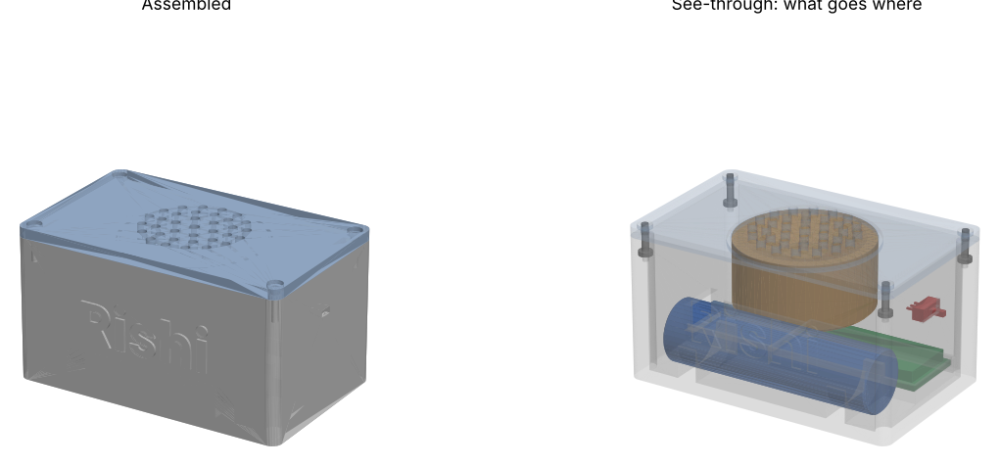
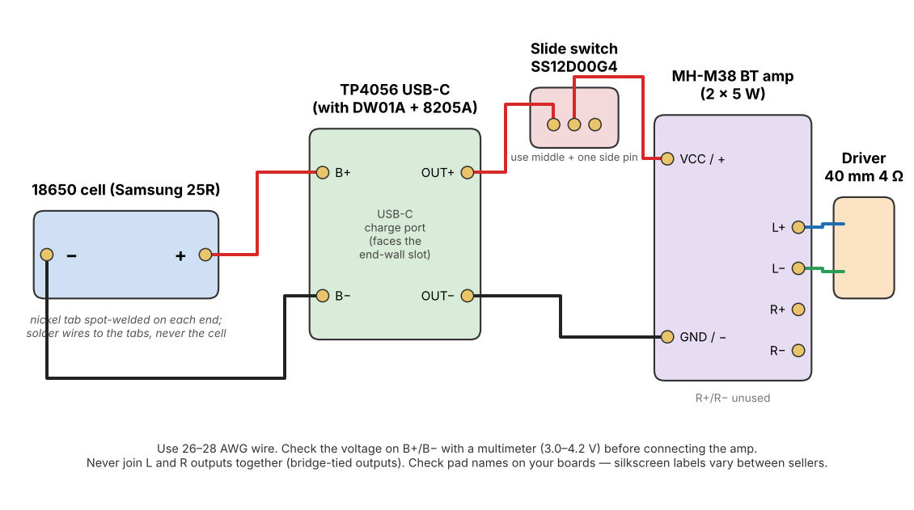
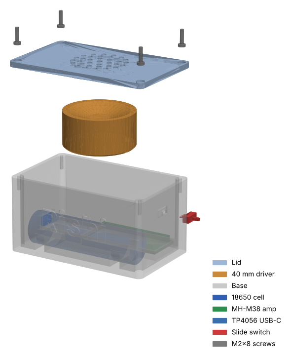

# Mini Bluetooth Speaker

A portable Bluetooth speaker with case made from a 3D printer. Powered by a single 18650 cell. It can be charged via USB-C. Part cost = ~$22 (+ postage, roughly $27+ total).



- **Case** - 83x52x46mm. 2 pieces. Assembled with 4 M2 screws.
- **Speaker** - 1x 40mm 4ohm speaker driver. Using an MH-M38 Bluetooth amp module.
- **Power** - Samsung 25R 18650 cell. TP4056 USB-C charging module with protection. Slide switch on end wall.

## Safety

Use caution when working with your bare 18650 lithium ion battery.

- Your cell has no protection. The TP4056 module will protect the cell from overcharging, over discharging and shorting. Only use a TP4056 with 3 chips (TP4056, DW01A & 8205A). Single chip modules will simply charge with no protection.
- Don’t solder directly onto the cell. Heat can damage the cell. Spot weld tabs onto the cell and solder to these.
- Purchase your cells from a battery dealer. 18650 cells sold on the marketplace are usually fake.
- Ensure you don’t short the metal ends of the cell or the wrapper. Tape them up until you are ready to connect them.
- Don’t leave the cell charging unattended for the first few charges. If the cell is getting warm, puffing up or tearing then stop using.

**Build and use at your own risk!**

## Components

All components listed with detailed specs, links & information. The most important column is the 'must match spec’. The component listings change, but any component that matches the spec will fit into your case. [BOM.csv](BOM.csv).

| # | Component | Qty | Must Match |
|---|-----------|-----|------------|
| 1 | Samsung INR18650-25R 18650 cell | 1 | Flat top, no protection. Max size 18.4x65.0mm. |
| 2 | MH-M38 Amplifier Module | 1 | M38 version (with amplifier). Approx 45x20mm. |
| 3 | TP4056 USB-C Charging Module with Protection | 1 | 3 Chip (TP4056, DW01A, 8205A). Approx 28x17mm. |
| 4 | 40mm 4ohm 3W Speaker Driver | 1 | 40mm diameter. Max height 20mm. |
| 5 | Pure Nickel Strip | 2 x 25mm | Must be pure nickel (not plated steel). 0.15x8mm. |
| 6 | M2 x 8mm Self Tapping Screw | 4 | Max head width 4.2mm. |
| 7 | SS12D00G4 Slide Switch | 1 | 4mm Lever. |
| 8 | PLA / PETG Filament | ~60g | |
| 9 | 26-28AWG Wire | | With Hot Glue. |

## Tools

- 3D Printer
- Soldering Iron & Solder
- Spot Welder (for welding tabs onto the cell). Or have a friend with one or take to a shop.
- Hot Glue Gun
- Small Phillips Head Screwdriver
- Multimeter
- Wire Strippers & Flush Cutters

## 1. Print case

All files can be found in [cad/print/](cad/print/). The STL files can be seen on GitHub and rotated in your browser.

| Component | File | Orientation |
|----------|------|-------------|
| Base | 01_enclosure_base.stl | Open side up. As exported. |
| Lid | 02_enclosure_lid.stl | Grille side down. As exported. |

Use the following settings for best results. Print using PLA or PETG. 0.2mm layers. 3 walls. 20% infill. Both components should print fine without any support. Check the preview in your slicer to make sure the USB-C and switch slots are clear.

Clean any stringing from the grille holes, USB-C and switch slots.

## 2. Check components

Before soldering anything, check your components fit. If they are slightly off they won’t fit.

1. Charging Module - Should have 3 chips. TP4056, DW01A & 8205A. If it only has 1 chip don’t use.
2. Speaker Driver - Should be 40mm wide. Max height 20mm. Otherwise it will hit the cell.
3. Amplifier Module - Approx 45x20mm. Dry fit into the pocket on the base. Pocket size = 45.6x20.6mm.
4. Screws - Holes in the lid are 4.4mm wide. Ensure the head of the screw will fit into the hole.
5. Switch - Push into the hole on the inside of the end wall. Lever should protrude through the slot and move freely.

## 3. Wiring



| From | To | Wire Colour |
|------|----|-------------|
| Cell + (Tab) | TP4056 B+ | Red |
| Cell - (Tab) | TP4056 B- | Black |
| TP4056 OUT+ | Switch (1 side pin) | Red |
| Switch (Middle Pin) | Amplifier (VCC / +) | Red |
| TP4056 OUT- | Amplifier (GND / -) | Black |
| Amplifier L+ | Speaker Driver (+) | |
| Amplifier L- | Speaker Driver (-) | |

Notes

- Only use one channel of the amplifier. Never connect the L and R outputs together. R+ & R- will be left blank.
- Names can slightly vary between suppliers. Check the silkscreen on your boards.
- Only use the middle pin and one side pin of the switch. Snip the 3rd pin short so it cannot touch anything.

1. Cut 2 pieces of nickel strip to 25mm. Spot weld 1 to each end of the cell.
2. Decide where each board will go in the base (see step 5). Cut your wires to length with a bit of extra.
3. Solder cell tabs to TP4056 B+ & B-. Measure across B+ & B-. You should get 3.0-4.2V.
4. Solder OUT+ to switch. Switch to Amplifier VCC. OUT- to Amplifier GND.
5. Solder L+ & L- to speaker driver.

## 4. Test (without assembly)

1. Plug a USB-C cable into the TP4056. LED will turn red whilst charging. Blue/Green when full.
2. Turn switch on. LED on Amplifier board should light up.
3. Open Bluetooth settings on your phone. Connect to the new device. Play something and check you can hear it from the speaker driver.
4. Turn switch off. Amplifier LED should turn off.

If there is an issue see troubleshooting below.

## 5. Assembly



1. Place cell into the cradle. Align with long side. Cover the welds on the tabs with some Kapton or electrical tape.
2. Place TP4056 into the end with the large slot. USB-C port should align with the slot so cable can be fully inserted. Glue into place with hot glue. Don’t get any glue into the port.
3. Press amplifier into the pocket. Next to the TP4056. Glue into place.
4. Press switch into the hole on the inside of the opposite end wall. Lever should protrude from slot. Check it moves freely. Glue around the body of the switch.
5. Place speaker driver into the round section on the underside of the lid. Cone facing the grille. Apply a bead of hot glue around the edge. Full seal will make a difference to bass.
6. Ensure all wires are tucked away. Nothing should be above the top edge of the base. Nothing should be pushing onto the speaker driver cone.
7. Place lid onto the base. Screw in the 4 M2x8 screws into the corner posts. Stop when they are tight. Self tapping screws can easily strip the printed plastic.

Final test. Turn switch on. Connect. Play. Charge via slot on end wall.

## Troubleshooting

| Issue | Solution |
|------|----------|
| No power | Check voltage on B+/B- of cell. If it shows close to 0 volts then the protection may have kicked in. Plug in USB-C for a few seconds to reset. Check pins on switch. |
| Not charging | Are B+/B- connected backwards? Is the USB-C cable fully plugged in through the slot? |
| Pairs but no sound | Is speaker driver connected to L+/L-? Is there a cold solder joint on the tabs of the speaker driver? |
| Distorted / Buzzing | Speaker driver is loose inside the lid. Reapply hot glue. Wire touching cone. |
| Drains battery when switched off | Is switch connected between OUT+ and Amplifier VCC? (Connecting to cell side will bypass protection board). |

## Files

```
cad/
├── speaker_cad.py   CadQuery source that regenerates everything in cad/
├── requirements.txt
├── print/        Parts to print
│   ├── 01_enclosure_base.step/.stl
│   └── 02_enclosure_lid.step/.stl
├── assembly/
│   ├── 00_full_assembly.step          All parts in place
│   └── 00_layout_flat_all_parts.step  All parts laid out flat
└── reference/    Parts to buy. Just check they fit. Don’t print.
    ├── 03_amp_board_DFR0720_MH-M38.step
    ├── 04_driver_40mm_adafruit_3968.step
    ├── 05_cell_samsung_INR18650-25R.step
    ├── 06_charger_module_TP4056_USB-C.step
    ├── 07_screw_M2x8_self-tapping.step
    ├── 08_nickel_tab_0.15x8x25mm.step
    └── 09_slide_switch_SS12D00G4.step
docs/
├── wiring.png/.svg
└── images/
hardware/
├── kicad/        KiCad schematic (open bt-speaker.kicad_pro)
├── wiring_schematic.pdf/.svg/.png
└── wiring.csv    Every connection as a list
firmware/
└── README.md     Why there is no firmware
```

All CAD drawings are in mm. All part files are in the same coordinate system as the assembly. Can be imported into any CAD tool and will be in the correct position.

If you are replacing a part, check against must match spec column in [BOM.csv](BOM.csv). Also check against the reference model. The tightest fit will be the height of the speaker driver (1.2mm clearance from cell) and amplifier pocket.

## Schematic and CAD source

- **Schematic** - Open `hardware/kicad/bt-speaker.kicad_pro` in KiCad 7 or newer. Exports are in `hardware/wiring_schematic.pdf/.svg/.png`. The schematic doesn't show the slide switch yet. For the switch, follow `docs/wiring.png` and `hardware/wiring.csv` (OUT+ to switch, switch to amplifier VBAT).
- **Regenerate the CAD** - `pip install -r cad/requirements.txt`, then `cd cad` and `python speaker_cad.py`. This rewrites every file in `cad/print`, `cad/reference` and `cad/assembly`. Dimensions are in the PARAMETERS block at the top of the script.
- **Change the name on the case** - `SPEAKER_NAME="Alex" python speaker_cad.py`. Use `SPEAKER_NAME=""` for no name. The lettering may come out in a slightly different font depending on your CadQuery version.
- **Firmware** - There isn't any. `firmware/README.md` explains why.

## Licence

CC BY 4.0. You are free to use, modify and share this design for commercial use. As long as you give credit to this repo.
